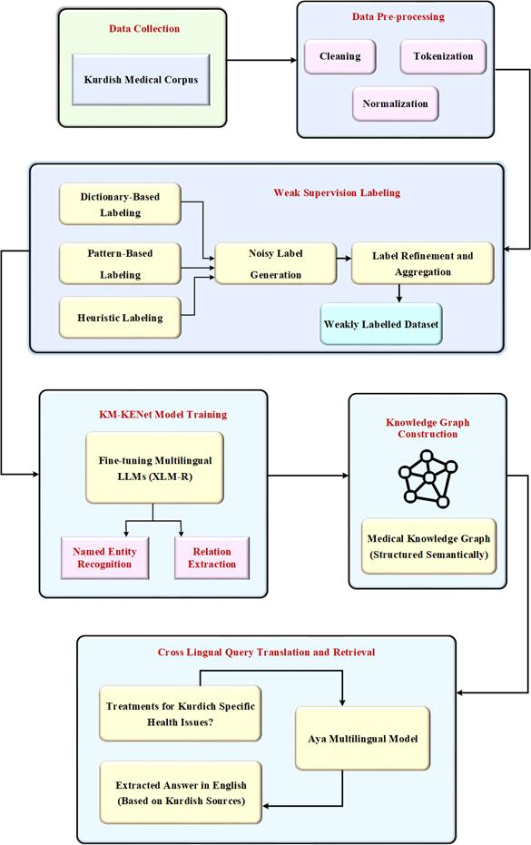

# KM-KENet — Kurdish Medical Knowledge Extraction Network

Official implementation of the article

> **A Weakly Supervised Multilingual Framework for Scientific Knowledge Extraction from Low-Resource Language Corpora**
> Shko Muhammed Qader, Zheng Wang — College of Intelligence and Computing, Tianjin University
> *Knowledge and Information Systems* (under review)

KM-KENet extracts medical knowledge from **Central Kurdish (Sorani)** text without manually annotated
training data. It labels the corpus automatically with weak supervision, fine-tunes a multilingual
transformer (XLM-R) for joint named entity recognition (NER) and relation extraction (RE), builds a
medical knowledge graph, and answers questions in English or Kurdish with the **Aya** multilingual model.



| Paper stage (Fig. 1) | Code | Main output |
| --- | --- | --- |
| Data Collection | `KM-KENet/step1_data_collection/` | `data/interim/corpus.jsonl` |
| Data Pre-processing (cleaning, normalization, tokenization) | `KM-KENet/step2_preprocessing/` | `data/processed/sentences.jsonl` |
| Weak Supervision Labeling (dictionary, pattern, heuristic LFs → noisy labels → label aggregation → weakly labelled dataset) | `KM-KENet/step3_weak_supervision/` | `data/weak_labels/{train,dev,test}.jsonl` |
| KM-KENet Model Training (XLM-R fine-tuning: NER + RE, joint loss L = α·L_NER + β·L_RE) | `KM-KENet/step4_model_training/` | `models/km_kenet/` + `test_results.md` |
| Knowledge Graph Construction | `KM-KENet/step5_knowledge_graph/` | JSON, RDF/Turtle (SPARQL), CSV, GraphML, Neo4j |
| Cross-Lingual Query Translation and Retrieval (Aya) | `KM-KENet/step6_cross_lingual_retrieval/` | grounded English answers |

**Entity types** (paper, Fig. 16): `DISEASE`, `SYMPTOM`, `DRUG`, `DOSAGE`, `PROCEDURE`, `BODY_PART`
**Relation types:** `TREATS`, `HAS_SYMPTOM`, `AFFECTS`, `DIAGNOSED_BY`, `HAS_DOSAGE`

## Dataset

The **Kurdish Medical Corpus (KMC) V1** — 121,918 human-written instruction–response pairs from 585 Kurdish
medical sources (6.1 M words, ~7.9 M tokens) — is published separately under CC BY 4.0:

* Hugging Face: <https://huggingface.co/datasets/shkomq/Kurdish_Medical_Corpus_KMC>
* Mendeley Data: <https://data.mendeley.com/datasets/cn5grbx63n/1>

`python -m setup.download_assets --only dataset` places `kurdish_medical_corpus_kmc.json` in
`Kurdish_Medical_Corpus_KMC/`, where the pipeline expects it.

## Quick check (5 minutes, CPU, no downloads)

The test suite runs every stage of the pipeline on a small **synthetic** sample written in the KMC format
(`KM-KENet/tests/fixtures/kmc_sample.json`) with a tiny randomly initialised XLM-R built offline. It shows
that the code runs end to end; the scores it prints are meaningless because the model is not trained.

```bash
cd KM-KENet
pip install torch --index-url https://download.pytorch.org/whl/cpu   # or any PyTorch >= 2.3
pip install -r requirements.txt
python -m pytest -q tests          # 19 tests, including the full 6-step pipeline
```

## Full reproduction

Requirements: Python ≥ 3.10, a CUDA GPU for training XLM-R large (the paper used an NVIDIA RTX 3060, 32 GB RAM).

```bash
cd KM-KENet
bash install.sh                      # virtual env + PyTorch + requirements + dataset + models
bash run.sh --venv .venv             # steps 1-6
```

Each step can also be run on its own (`python -m step3_weak_supervision.main`, …), and any configuration
value can be changed from the command line, e.g. `bash run.sh --from 4 --override training.epochs=3`.
All settings live in [`KM-KENet/configs/config.yaml`](KM-KENet/configs/config.yaml).

### Training configuration (paper, Table 2)

| Hyperparameter | Value | Config key |
| --- | --- | --- |
| Encoder | XLM-R large (hidden 1024, 24 layers, 16 heads) | `model.encoder` |
| Maximum sequence length | 256 tokens | `model.max_length` |
| Dropout / attention dropout | 0.1 / 0.1 | `model.dropout` |
| Optimizer | AdamW | — |
| Learning rate | 2 × 10⁻⁵ | `training.encoder_learning_rate` |
| Weight decay | 0.01 | `training.weight_decay` |
| Batch size | 16 | `training.batch_size` |
| Epochs | 10 (early stopping on the dev split) | `training.epochs` |
| Loss | cross-entropy (NER) + cross-entropy (RE), weights α, β | `training.ner_loss_weight`, `training.relation_loss_weight` |
| Data split | 80 % training (incl. validation) / 20 % test, by source book | `weak_supervision.split` |

On a small GPU or a CPU use XLM-R base: `--override model.encoder=FacebookAI/xlm-roberta-base`.

### Evaluation

```bash
python -m step4_model_training.evaluate            # test split → models/km_kenet/test_results.md + ROC curves
python -m step4_model_training.cross_validation    # 5-fold cross-validation → models/km_kenet/cross_validation/
```

Reported measures follow Table 3 of the paper — Accuracy, Precision, Recall, Specificity, F1-score and
ROC-AUC — computed one-vs-rest per entity / relation type and macro-averaged
([`paper_metrics.py`](KM-KENet/step4_model_training/paper_metrics.py)). Span-level NER scores (seqeval)
are reported alongside. The cross-validation splits folds by source book, so sentences of one book are
never in both training and evaluation folds.

Results reported in the paper:

| Model | Accuracy | Precision | Recall | Specificity | F1-score | AUC |
| --- | --- | --- | --- | --- | --- | --- |
| KM-KENet | 95.34 % | 94.76 % | 95.89 % | 94.98 % | 95.32 % | 0.9828 |

Exact values depend on the hardware, library versions and random seed (`project.seed`).

### Knowledge graph and SPARQL

Step 5 writes `outputs/knowledge_graph/` with `knowledge_graph.json`, `knowledge_graph.ttl` (RDF/Turtle),
`triples.csv`, `knowledge_graph.graphml`, `neo4j_import.cypher` and a PNG preview. Every edge stores its
support (number of sentences), confidence and evidence sentences.

```bash
python -m step5_knowledge_graph.sparql             # runs queries/example_queries.sparql with rdflib
```

### Cross-lingual question answering (Aya)

```bash
python -m step6_cross_lingual_retrieval.main --query "What are the treatments for thalassemia?"
python -m step6_cross_lingual_retrieval.main --interactive
```

Step 6 uses `CohereLabs/aya-expanse-8b` (gated on Hugging Face: accept its licence and `export HF_TOKEN=...`;
`retrieval.aya.load_in_4bit: true` for GPUs with less memory) or the Cohere API (`backend: cohere`). Without
Aya it still runs, using lexicon-based translation and template answers built from the knowledge graph.

## Repository layout

```
├── KM-KENet/                    # the framework (run everything from this folder)
│   ├── configs/config.yaml      # all settings
│   ├── common/                  # config, logging, I/O, annotation schema, lexicon loading
│   ├── step1_data_collection/ … step6_cross_lingual_retrieval/
│   ├── resources/               # Sorani medical lexicon, stopwords, English–Kurdish glossary
│   ├── queries/                 # example SPARQL queries
│   ├── setup/download_assets.py # dataset + model download
│   ├── tests/                   # unit tests + end-to-end smoke test (synthetic data)
│   ├── install.sh, run.sh
│   └── README.md                # detailed technical documentation
├── Kurdish_Medical_Corpus_KMC/  # dataset folder (data downloaded on demand)
├── docs/                        # figures
├── download_kmc.py              # mirror the full dataset repository (incl. source PDFs)
├── CITATION.cff, LICENSE
```

## Citation

```bibtex
@article{qader2026kmkenet,
  title   = {A Weakly Supervised Multilingual Framework for Scientific Knowledge Extraction from Low-Resource Language Corpora},
  author  = {Qader, Shko Muhammed and Wang, Zheng},
  journal = {Knowledge and Information Systems},
  year    = {2026},
  note    = {Under review}
}

@dataset{kmc_v1_2026,
  title     = {Kurdish Medical Corpus (KMC) V1},
  author    = {Qader, Shko Muhammed and Wang, Zheng},
  year      = {2026},
  publisher = {Hugging Face},
  url       = {https://huggingface.co/datasets/shkomq/Kurdish_Medical_Corpus_KMC}
}
```

## License and contact

Code: MIT (see [LICENSE](LICENSE)). Dataset: CC BY 4.0.
Questions: Shko Muhammed Qader — shkomq@tju.edu.cn

The system is a research prototype; its answers are not medical advice.
